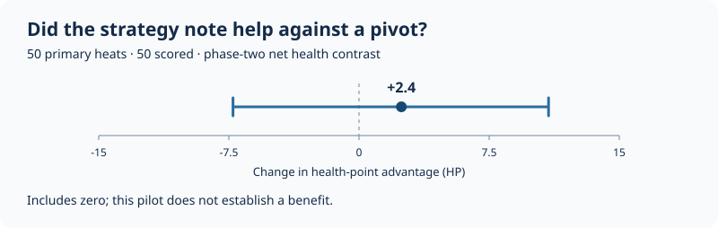

# Agent Arcade Cup

Can a fresh AI player inherit a strategy without inheriting a conversation?

A research extension of [100 Games](https://github.com/NnopponS/100-games) using the pinned native FightingICE v7.0 engine, not the retired puzzle format. All contestants used **GPT-6.2 Sol, low reasoning effort**.

## Verified result

**Cup champion: FI-005**. See the [research report](results/README.md) for the final adjudication, scoring rules and evidence.

- **100 fresh competitors** across **50 opening heats**, all with both genuine speakers.
- **100 directed replies** tied to the delivered opponent message in those primary heats.
- **49 knockout decisions**: 39 full native fixtures and 10 invalid-format forfeits before full play. Mirrored native tie-breaks are counted separately.
- Replacement runtimes carried forward the same documented public profile, not the original model session or its hidden memory.



The assignment encouraged an opponent style change, rather than forcing a native move. This is one matchup and model setting, with repeated note lineage and limited sample size. The selected replay illustrates what happened, not the average result.

## Reproduce

- [Audited match results and roster](results/audited-match-results.json)
- [Observed primary decisions and dialogue](results/observed-heats.jsonl)
- [HP estimates](results/summary.json) and [exploratory token diagnostics](results/token-diagnostics.json)
- [Frozen protocol](fighting-study/PROTOCOL.md), [knockout wording change](fighting-study/KNOCKOUT-PROMPT-CHANGE.md) and [reporting notes](fighting-study/report/REPORTING.md)
- [Native engine bridge](fightingice/README.md) and [video production plan](edit/fighting/story-plan.json)

```sh
python fighting-study/report/recompute-public.py results/observed-heats.jsonl results/summary.json
```

The previous [puzzle protocol](primary/README.md) and [fixed-bot calibration](arena/evidence/verified-summary.json) are archived and excluded from all FightingICE findings. Native run paths, raw notes, game artwork and audio are not published here.
