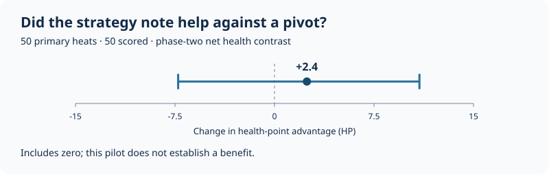

# Agent Arcade Cup: what happened when strategies changed?

**Champion: FI-005**. Final record: K049, FI-052 vs. FI-005.

A fighting-game tournament and an exploratory study of how identically configured agents adapt during a match.

## The setup

- 100 distinct, fresh contestant runtimes, 50 opening heats and 100 recipient-linked replies in the primary heats. Two contestants at a time, not 100 simultaneous processes.
- DareFightingICE v7.0 (3780b5e), identical ZEN fighters with 400 HP. Each agent chose four legal commands per half; the engine waited for both decisions before stepping through the commands.
- Every contestant used **GPT-6.2 Sol, reasoning effort low**. Other models were not tested. This is a turn-gated native game evaluation, not an official real-time contest.
- Each player saw its opponent's real opening line at the break. A hash binds each recorded reply to the actual line delivered. On-engine state, not what a contestant said it intended to do, determines the result.

## Did a strategy note change performance?

| Assigned note | Opponent instruction | Scored heats | Mean phase-two net HP change | Assigned note unavailable |
|---|---|---:|---:|---:|
| method | pivot | 13 | +0.54 HP | 0 |
| method | stay | 12 | +0.08 HP | 1 |
| neutral | pivot | 12 | -0.83 HP | 0 |
| neutral | stay | 13 | +1.15 HP | 0 |

The exploratory note-by-pivot estimate was **+2.44 HP**; the 95% bootstrap interval was **[-7.26, +10.92] HP**. This pilot does not establish that the note improved performance. Restricting to heats where the assigned card was delivered gives +0.98 HP (descriptive sensitivity check).

Under the exploratory spacing proxy, **23/25** pivot-assigned opponents shifted in the intended direction. This refers to requested commands (advance vs retreat or guard), not guaranteed native actions.

An exact-token diagnostic is provided separately. It measures overlap in the four requested commands between phases; rearrangement alone does not count. The response-family taxonomy in the draft protocol was not frozen before data collection, so this is not a confirmatory behavioral result.

## What continued after a runtime ended?

Fifty winning profiles entered 49 bracket decisions. Across regular knockout seats, 3 retained an observed native runtime and 95 were rehydrated under their same public ID with an explicit prior note when available. Rehydration is not memory recovery, and runtime retention was not randomized.
The 49 regular knockout fixtures included 39 on-engine finishes and 10 invalid-submission forfeits. A forfeit was not scored as a played fight, and its missing dialog or inputs were not reconstructed.
Brackets exclude mirrored tie-breaks from the 49-decision count. The native log also contains 5 additional tie-break matches and 2 engine recovery records.

An independent execution of all 94 completed bouts in a fresh pinned engine matched 1,034 normalized barrier hashes and 1,128 sampled frame/HP receipts. It replayed the accepted commands and did not rerun model decisions.

## Limits and reproduction

- One model setting, one character mirror and short decision windows. A private instruction encourages style; it does not force a physical move. One strategy note may influence later notes, so naïve bootstrap intervals do not account for note-lineage dependence.
- Case footage is original animation rebuilt from the pinned engine state. A selected comeback shows what happened in one heat, not what an average heat looked like.
- Final scores and reply binding are separately auditable from actual accepted inputs. Public-profile IDs are pseudonyms. No private runtime identifiers, raw handoff notes, authentication data or game assets are included.

See the accompanying observed-heats JSONL, audited-match results JSON, HP summary and token diagnostics for the tables and exact denominators.
